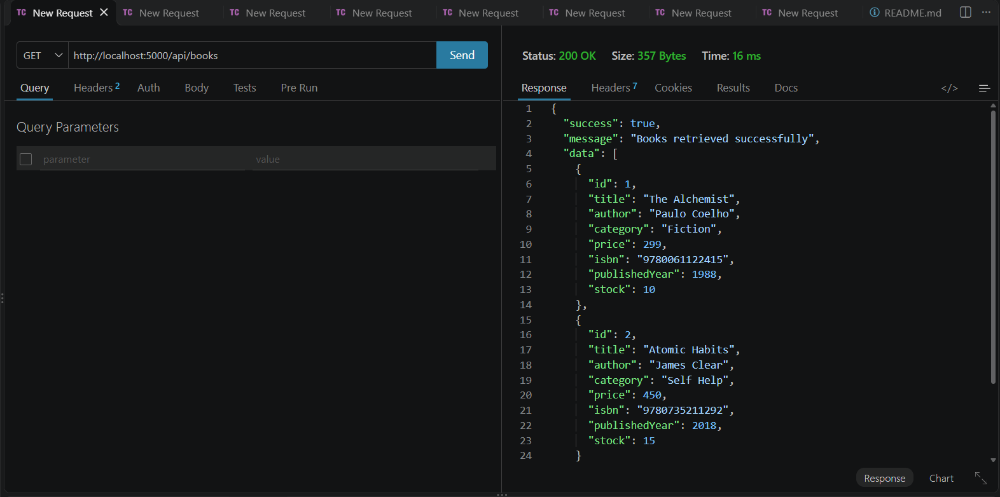
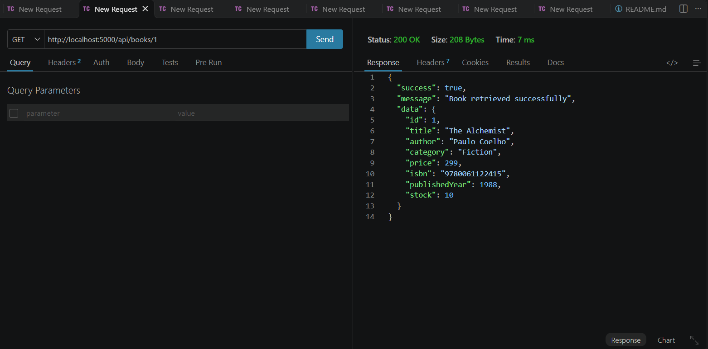
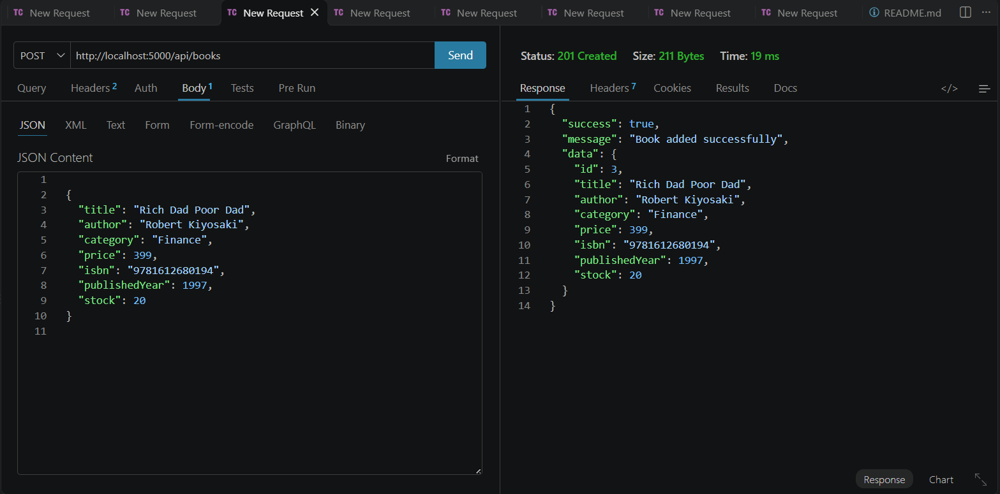
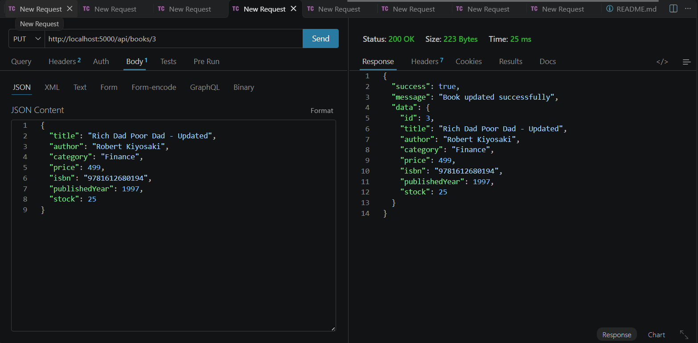
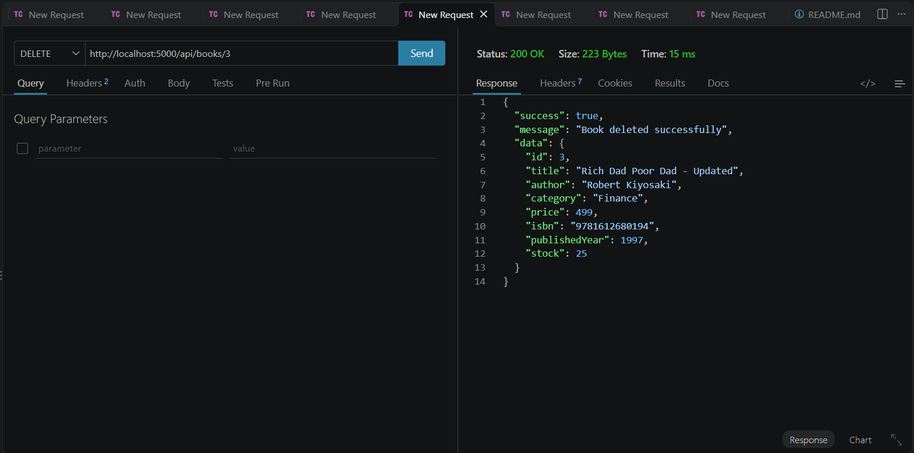
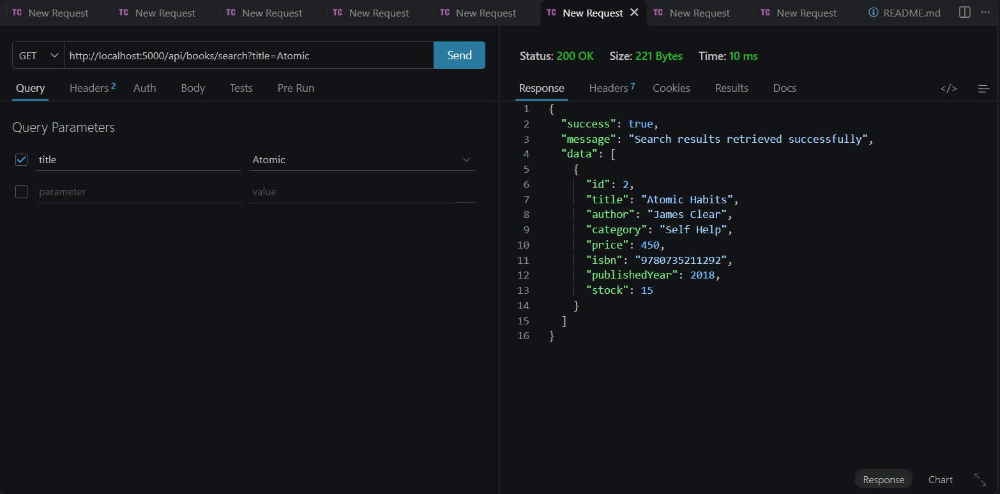
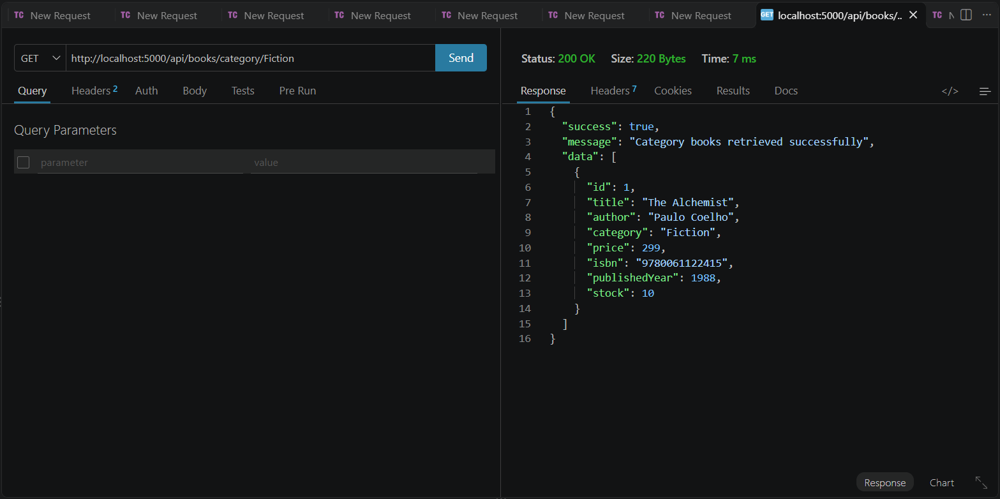
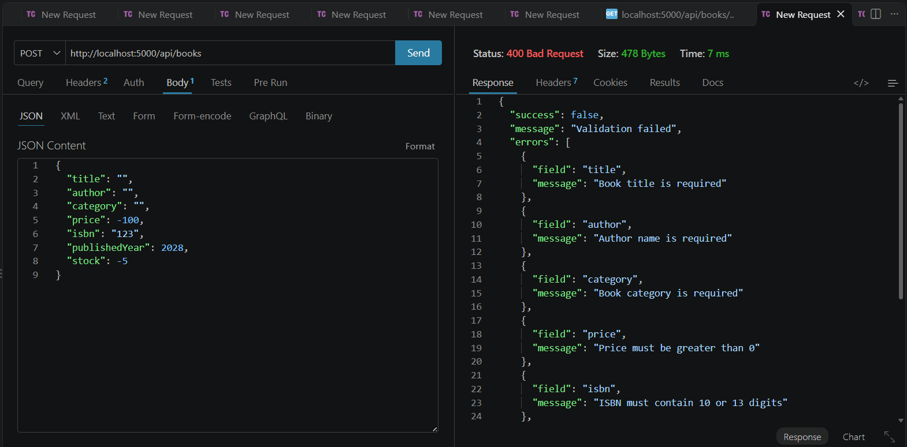

# Day 13 - REST API Development using Express.js

## Project Overview

This project is a Book Management REST API developed using Node.js and Express.js as part of the ApexLark Full Stack Development Internship Program.

The API allows users to manage book inventory through CRUD operations, search books by title, and filter books by category.

## Technologies Used

- Node.js
- Express.js
- JavaScript
- dotenv
- CORS
- Morgan
- express-validator
- Thunder Client

## Project Structure


## Project Structure

Day-13-REST-API/
│
├── config/
│   └── config.js
│
├── controllers/
│   └── bookController.js
│
├── data/
│   └── books.json
│
├── middleware/
│   ├── errorHandler.js
│   ├── logger.js
│   └── validator.js
│
├── models/
│   └── bookModel.js
│
├── routes/
│   └── bookRoutes.js
│
├── node_modules/
│
├── .env
├── app.js
├── package.json
├── package-lock.json
└── README.md

## Installation

1. Clone the repository.

```bash
git clone YOUR_GITHUB_REPOSITORY_URL
```

2. Navigate to the project folder.

```bash
cd Day-13-REST-API
```

3. Install dependencies.

```bash
npm install
```

4. Start the development server.

```bash
npm run dev
```

Server URL:

http://localhost:5000

## API Endpoints

| Method | Endpoint | Description |
|---|---|---|
| GET | /api/books | Get all books |
| GET | /api/books/:id | Get book by ID |
| POST | /api/books | Add a new book |
| PUT | /api/books/:id | Update a book |
| DELETE | /api/books/:id | Delete a book |
| GET | /api/books/search?title= | Search books by title |
| GET | /api/books/category/:name | Filter by category |

## Sample POST Request

```json
{
  "title": "Rich Dad Poor Dad",
  "author": "Robert Kiyosaki",
  "category": "Finance",
  "price": 399,
  "isbn": "9781612680194",
  "publishedYear": 1997,
  "stock": 20
}
```

## Features

- Complete CRUD operations
- Search books by title
- Filter books by category
- Request validation using express-validator
- Morgan request logging
- Global error handling
- Standardized JSON responses
- JSON file-based data storage

## Testing

All API endpoints were tested using Thunder Client.

Testing includes:

- GET all books
- GET book by ID
- POST new book
- PUT update book
- DELETE book
- Search by title
- Category filtering
- Validation failure testing

## API Testing Screenshots

### 1. Get All Books


### 2. Get Book by ID


### 3. Add New Book (POST)


### 4. Update Book (PUT)


### 5. Delete Book (DELETE)


### 6. Search Books by Title


### 7. Get Books by Category


### 8. Validation Error


## Task

Day 13 - REST API Development using Express.js
